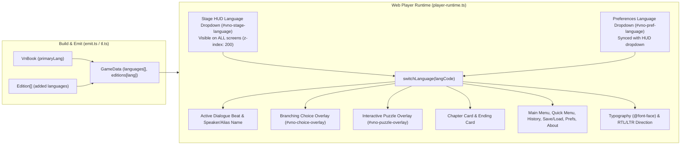

# VNO-41: Persistent Per-Screen Language Switcher Dropdown

Branch: `VNO-41_screen-language-switcher` (cut from `origin/master` `79c8a19`).

## Checklist (VN Studio, VNO-41)

- [x] **Game Data Emitter (`src/engine/game/emit.ts`)**:
  - Deduplicate `allLangs` in `buildGameData` so `gameData.languages` starts with `book.primaryLang` followed by unique edition languages in order.
  - Add `speakerAliasKey?: string` to `GameDataSceneBeat` and populate `"${b.speakerKey}#${aliasIdx}"` when `aliasIndex(char, b.speakerLabel) > 0`.
- [x] **Web Player HTML, CSS & Runtime (`src/engine/game/player-runtime.ts`)**:
  - Emit a persistent top-right stage HUD language dropdown (`#vno-lang-bar` / `#vno-stage-language`) inside `#vno-stage` alongside `#vno-pref-language` in Preferences, plus stable IDs for all screen headers and labels.
  - Style `.vno-lang-bar` (`z-index: 200`, `pointer-events: auto`, RTL-aware positioning) so it is accessible on every screen (Main Menu, Dialogue, Chapter Card, Choices, Puzzles, Ending, History, Save/Load, Preferences, About).
  - Stop click/mousedown/keydown propagation on `#vno-lang-bar` so using the dropdown never triggers stage advance or dismisses a chapter card.
  - Implement comprehensive `switchLanguage(langCode)` and `refreshActiveScreens()` that sync all language `<select>` elements, apply language typography (`dir`, `lang`, `fontFamily`), immediately re-render the current screen (active dialogue beat + emphasis + speaker/alias name, chapter card, branching choices with `ch.number + ':' + i`, interactive puzzles preserving struck clues, ending card, history log entries, save/load, preferences, about, main menu, and quick menu UI strings), and keep the chosen language active from that point forward.
  - Expose `switchLanguage` and `getLanguages` on `window.VNOEngine`.
- [x] **Roadmap & Tests (`ROADMAP.md`, `tests/renpy-template.test.ts`)**:
  - Update `ROADMAP.md` with VNO-41.
  - Add comprehensive runtime and DOM tests in `tests/renpy-template.test.ts` verifying per-screen language switching across dialogue, aliases, choices, chapter cards, ending cards, puzzles, main menu, and history, and proving that the selected language continues to be active on subsequent beats/screens.
  - Verify `yarn test` (976 tests in 69 files), `yarn typecheck`, and `yarn lint` pass cleanly.

## Goal Description

Allow players to switch the active language from **any screen** in the built visual novel via an always-accessible language dropdown (for example, starting a novel in German and switching to English or Croatian on any dialogue screen, choice menu, puzzle screen, chapter title card, ending screen, or main menu when learning a language).

Selecting a language from the dropdown is **not** a one-line peek toggle: it immediately re-renders the current screen in the chosen language and **continues with that language active** for all subsequent beats, scenes, choices, puzzles, chapters, and UI screens from that point onward until the player selects another language.

---

## Architecture & Data Flow



---

## Proposed Changes

### 1. Game Data Emitter (`src/engine/game/emit.ts`)

#### [MODIFY] [emit.ts](file:///c:/projects/Personal/visual-novels-orchestrator/src/engine/game/emit.ts)
- **Deduplicate language list**: Ensure `allLangs` in [`buildGameData`](file:///c:/projects/Personal/visual-novels-orchestrator/src/engine/game/emit.ts#L594-L607) starts with `book.primaryLang` followed by unique edition language codes in order.
- **Speaker alias key on beats**: Add `speakerAliasKey?: string` to [`GameDataSceneBeat`](file:///c:/projects/Personal/visual-novels-orchestrator/src/engine/game/emit.ts#L491-L502). When a `line` beat uses a character alias (`aliasIndex(char, b.speakerLabel) > 0`), populate `speakerAliasKey: "${b.speakerKey}#${aliasIdx}"` so the runtime can look up localized character aliases (`currentEdition.characterNames[beat.speakerAliasKey]`) when switching languages on any dialogue screen.

```ts
export interface GameDataSceneBeat {
  id: string
  type: 'line' | 'narration' | 'cast' | 'puzzle'
  speaker?: string | null
  speakerAliasKey?: string
  speakerLabel?: string
  text?: string
  html?: string
  stage?: BeatStagePlan
  puzzleKey?: string
  onFail?: { mode: 'retry' | 'continue' | 'chapter'; to?: number; maxTries?: number }
  failTargetLabel?: string
}
```

---

### 2. Web Player HTML, CSS & Runtime (`src/engine/game/player-runtime.ts`)

#### [MODIFY] [player-runtime.ts](file:///c:/projects/Personal/visual-novels-orchestrator/src/engine/game/player-runtime.ts)

1. **Always-Visible Stage Language Dropdown in [`generateIndexHtml`](file:///c:/projects/Personal/visual-novels-orchestrator/src/engine/game/player-runtime.ts#L10-L239)**:
   - Add a persistent top-right HUD language bar inside `#vno-stage`:
     ```html
     <!-- Persistent Stage Language Switcher (accessible on every screen) -->
     <div id="vno-lang-bar" class="vno-lang-bar" title="Language">
       <label for="vno-stage-language" id="vno-lang-bar-label" class="vno-lang-bar-label">&#127760;</label>
       <select id="vno-stage-language" class="vno-lang-select" aria-label="Language"></select>
     </div>
     ```
   - Add stable element IDs to screen titles and preference labels (`#vno-history-title`, `#vno-prefs-title`, `#vno-about-title`, `#vno-about-book-title`, `#vno-pref-label-display`, `#vno-pref-label-language`, `#vno-pref-label-text-speed`, `#vno-pref-label-auto-delay`, `#vno-pref-label-vol-music`, `#vno-pref-label-vol-sfx`, `#vno-pref-label-vol-voice`) so all modal screens localize dynamically when the language changes.

2. **HUD Language Bar Styling in [`generatePlayerCss`](file:///c:/projects/Personal/visual-novels-orchestrator/src/engine/game/player-runtime.ts#L245-L877)**:
   - Style `.vno-lang-bar` at `position: absolute; top: 20px; right: 28px; z-index: 200; pointer-events: auto;` (above `.vno-fullscreen-card` at `z-index: 50`, `.vno-overlay` at `z-index: 60`, and `.vno-screen` at `z-index: 100`) so it is reachable on the Main Menu, Dialogue stage, Chapter Card, Choice menu, Puzzle overlay, Ending card, and Modal screens.
   - Mirror `.vno-lang-bar` to `left: 28px; right: auto;` under `[dir="rtl"]` (or keep it unobtrusive in the top corner without colliding with `.vno-screen-close`).

3. **Comprehensive Live Language Switching in [`generatePlayerJs`](file:///c:/projects/Personal/visual-novels-orchestrator/src/engine/game/player-runtime.ts#L879-L1733)**:
   - **Starting Language & Continuation**:
     - Initialize `currentLang = gameData.primaryLang || 'en'` on `loadGameData`.
     - Populate both `#vno-stage-language` and `#vno-pref-language` with all languages in `gameData.languages`.
     - Stop click/mousedown/keydown event propagation on `#vno-lang-bar` so opening or changing the dropdown never advances dialogue or dismisses a chapter title card.
     - When the user selects a language in either dropdown, call `switchLanguage(langCode)`:
       - Update `currentLang` and `currentEdition = gameData.editions[langCode]`.
       - Sync the selected value across `#vno-stage-language` and `#vno-pref-language`.
       - Keep `currentLang` active across all subsequent beats, scenes, chapters, choices, puzzles, and restarts until changed again.
   - **Typography & Script Font Application (`applyLanguageTypography`)**:
     - Set `document.documentElement.dir` (`rtl` / `ltr`) and `document.documentElement.lang`.
     - Apply the active language's `fontFamily` from `gameData.languages` to `dom.stage` and `dom.dialogueText`.
   - **Live Re-render of Every Screen (`refreshActiveScreens`)**:
     - **Dialogue / Narration Screen**:
       - Format localized beat text with HTML emphasis (`**bold**`, `*italic*`, `{b}`, `{i}`).
       - If typewriter animation is in progress (`isTyping`), complete it immediately with the new language's text so no stale characters from the previous language are typed.
       - Update `#vno-speaker-name` using `getLocalizedCharacterName(beat)` (supporting `beat.speakerAliasKey`, `beat.speaker`, and `beat.speakerLabel`).
     - **Chapter Title Card (`#vno-chapter-card`)**:
       - If visible, immediately update `#vno-chapter-card-text` to `getLocalizedChapterTitle(currentChapterIdx, ch.title)`.
     - **Branching Choices Screen (`#vno-choice-overlay`)**:
       - Fix choice key lookup to use `ch.number + ':' + i` (matching `compileEditions` in `tl.ts`).
       - If `#vno-choice-overlay` is visible, re-render the choice buttons in the newly selected language.
     - **Interactive Puzzle Screen (`#vno-puzzle-overlay`)**:
       - Update `renderBuiltinPuzzle` to read localized puzzle strings (`currentEdition.puzzles[pz.key]`) for clues, statements, evidence, questions, and item names across `murdle`, `logic`, `knights`, `testimony`, and `quiz`.
       - Track `activePuzzleState` (including struck clues) while `#vno-puzzle-overlay` is open and re-render the puzzle in place when `switchLanguage` is called.
     - **Ending Screen (`#vno-ending-card`)**:
       - Update `showEnding` and `refreshActiveScreens` to use `currentEdition.endings[ch.number]` (or localized `ui('The End', 'The End')` when no custom ending message is set).
     - **History Screen (`#vno-screen-history`)**:
       - Store `{ beatId, speaker, speakerAliasKey, speakerLabel, fallbackText }` in `dialogueHistory` entries so opening History or switching language while History is open displays all logged lines in the currently active language.
     - **Main Menu, Quick Menu, Save/Load, Preferences & About UI Strings (`updateUiStrings`)**:
       - Apply `currentEdition.title` to `document.title`, `#vno-mm-title`, and `#vno-about-book-title`.
       - Localize Main Menu buttons, Quick Menu buttons, Save/Load titles and empty-slot labels, Preferences labels, History title/empty message, and Ending buttons via `currentEdition.ui`.
   - **Engine API (`window.VNOEngine`)**:
     - Expose `switchLanguage(langCode)` and `getLanguages()` on `window.VNOEngine`.

---

### 3. Roadmap & Ticket Tracking (`ROADMAP.md`)

#### [MODIFY] [ROADMAP.md](file:///c:/projects/Personal/visual-novels-orchestrator/ROADMAP.md)
- Add **VNO-41** to `ROADMAP.md` referencing `.claude/tickets/VNO-41-screen-language-switcher/plan.md`.

---

## Verification Plan

### Automated Tests
1. **Unit & Runtime Tests (`tests/renpy-template.test.ts` & new DOM/runtime tests)**:
   - Verify `#vno-stage-language` and `#vno-pref-language` are emitted in `index.html` and styled above all screens (`z-index: 200`).
   - Execute the generated player runtime in a simulated DOM / `jsdom` or `Function` harness with a multi-language `GameData` payload (`de`, `en`, `hr`) and verify:
     - Starting language defaults to `primaryLang` (`de`).
     - Selecting `en` or `hr` in `#vno-stage-language` on a **dialogue screen** updates `#vno-dialogue-text` and `#vno-speaker-name` (including character aliases) immediately, and advancing to the next beat continues in `en` / `hr`.
     - Selecting another language while on a **branching choice screen** (`#vno-choice-overlay`) updates all choice button labels immediately.
     - Selecting another language while on a **chapter title card** (`#vno-chapter-card`) or **ending card** (`#vno-ending-card`) updates the card text immediately.
     - Selecting another language while on a **puzzle screen** (`#vno-puzzle-overlay`) updates clue texts and item names immediately while preserving struck clues.
     - Selecting another language on the **main menu** or **history screen** updates the title, menu buttons, and history entries immediately.
   - Run the full test suite, typecheck, and linter:
     ```powershell
     yarn test
     yarn typecheck
     yarn lint
     ```

### Manual Verification
- Build a novel with multiple editions (e.g., Croatian and English, or German, English, and Croatian) from the **Build** tab and click **Play**.
- Use the top-right language dropdown on the Main Menu, Chapter Card, Dialogue screens, Choice menus, Puzzle screens, and History screen to switch between languages and confirm the selected language updates the current screen immediately and remains active on all subsequent screens.
